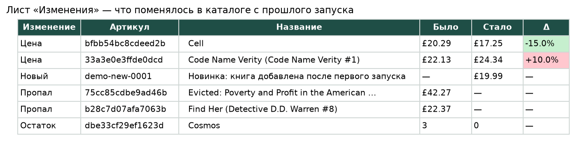

# Парсер каталога → Excel с историей цен

Программа обходит каталог интернет-магазина, собирает карточки товаров и выгружает их в Excel. При каждом запуске она сравнивает каталог с прошлым и показывает, что изменилось: цены, остатки, новые и снятые товары.



Пример готового файла: [samples/catalog_sample.xlsx](samples/catalog_sample.xlsx).

## Задача

Типовой запрос от магазинов и закупщиков: «нужна таблица с товарами конкурента, и чтобы было видно, где поменялась цена». Простая выгрузка в Excel с этим не справляется. Сравнивать два файла вручную долго, а парсер, который падает на первой битой карточке, приходится постоянно перезапускать.

Демо-источник — [books.toscrape.com](https://books.toscrape.com), учебный магазин, созданный специально для отработки парсинга: 1000 товаров на 50 страницах.

## Как устроено

**Устойчивость к сбоям.** Запросы автоматически повторяются при обрывах сети и ответах 429/5xx с нарастающей паузой, учитывается заголовок `Retry-After`. Если одна карточка не разобралась, обход продолжается, а ссылка с причиной ошибки попадает на отдельный лист «Ошибки».

**Скорость.** Карточки скачиваются параллельно в 8 потоков. Весь каталог (1000 товаров) собирается примерно за 35 секунд.

**История в SQLite.** Каждый запуск сохраняется как снимок каталога. Товары сравниваются по артикулу, а не по названию или позиции на странице, поэтому смена сортировки на сайте не порождает ложных изменений.

**Удобный Excel.**
- **«Товары»** — артикул, название, категория, цена, остаток, рейтинг, ссылки на карточку и фото. Включены фильтр и закреплённая шапка, малые остатки подсвечены.
- **«Изменения»** — что поменялось с прошлого запуска. Подешевевшее выделено зелёным, подорожавшее — красным, указан процент изменения.
- **«Сводка»** — по категориям: количество товаров, минимальная, средняя и максимальная цена, остаток. Итоги посчитаны формулами Excel, а не просто вписаны числами.

**Перенос на другой сайт.** Логика обхода, повторов, истории и выгрузки от сайта не зависит. Под новый магазин переписываются только две функции разбора: страница каталога и карточка товара.

## Результат демо-прогона

```
1. Первый запуск: весь каталог
товаров 1000, ошибок 0, за 36 с
категорий 50, артикулов уникальных 1000

2. Второй запуск: в магазине за это время что-то поменялось
  Цена     Cell                                    20.29 → 17.25 (-15%)
  Цена     Code Name Verity (Code Name Verity #1)  22.13 → 24.34 (+10%)
  Новый    Новинка: книга добавлена после первого запуска
  Пропал   Evicted: Poverty and Profit in the American City
  Пропал   Find Her (Detective D.D. Warren #8)
  Остаток  Cosmos                                  3 → 0

изменений найдено: 6 (ожидалось 6)
```

Демо-сайт статичен, цены на нём не меняются, поэтому изменения ко второму запуску вносятся в `run_demo.py` явно: скидка, подорожание, распроданный остаток, два снятых товара и одна новинка. Так проверяется, что сравнение находит каждый вид изменений.

## Запуск

```bash
pip install -r requirements.txt
python catalog_parser.py                 # весь каталог → catalog.xlsx
python catalog_parser.py --pages 5       # первые 5 страниц
python run_demo.py                       # два запуска и отчёт об изменениях
python -m pytest -q                      # тесты, работают без интернета
```

Повторный запуск `catalog_parser.py` автоматически сравнивает каталог с предыдущим и заполняет лист «Изменения». Для регулярного мониторинга достаточно поставить его в планировщик Windows или cron.

## Файлы

| Файл | Назначение |
|---|---|
| `catalog_parser.py` | обход, разбор, история в SQLite, сравнение, выгрузка в Excel |
| `run_demo.py` | сквозной сценарий: два запуска и отчёт об изменениях |
| `make_preview.py` | картинка для README из готового Excel |
| `tests/` | тесты на сохранённых страницах: разбор, устойчивость к битым карточкам, сравнение, Excel |
| `samples/catalog_sample.xlsx` | готовый отчёт после демо-прогона |

Стек: Python 3.12+, requests, BeautifulSoup + lxml, openpyxl, SQLite.
